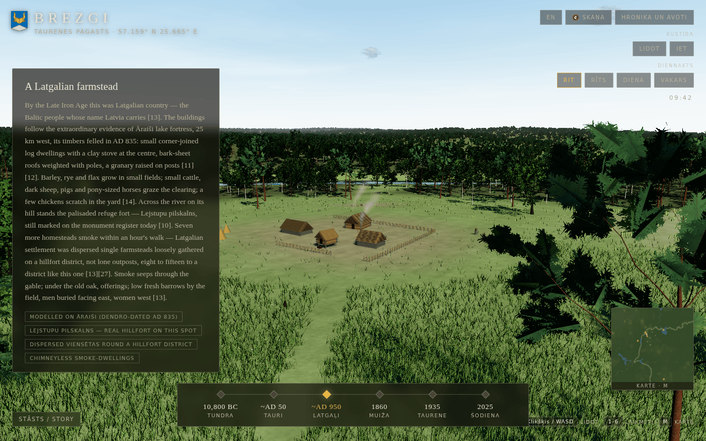

# Brezgi — a Latvian village through time



An interactive Three.js reconstruction of the landscape around the Brezgi
farmstead site in **Taurenes pagasts** (formerly Nēķenes pagasts / Nötkenshof),
Vidzeme, Latvia — the same spot of earth shown at six moments in time:

| Era | Scene |
|---|---|
| ~10,500 BC | Younger Dryas shrub tundra, reindeer and buried dead ice |
| ~AD 50 | A small Early Iron Age farm with burn plots and stone-ringed graves, aurochs in the forest meadows |
| ~AD 950 | A Latgalian farmstead, modelled on the Āraiši lake-fortress evidence |
| 1860 | The Brezgi viensēta under Nēķens manor, the mill pond and the old highway over Brežģa kalns |
| 1935 | Taurene, independent Latvia — farms after agrarian reform, the old palace a clinic |
| 2025 | Surveyed woodland and buildings, the Brežģa kalns tower and modern parish |

## Real geography

- **Terrain**: bare-earth ground from the national airborne laser survey (LĢIA,
  flown here in October and November 2019, CC BY 4.0), 8.8 × 8.8 km covering
  Taurene and Brezģis, on a 4 m grid with a 1 m patch over Lejstupu pilskalns.
  The gravel pit and the cuttings of the post-war P30 are smoothed out, so every
  era shares a pre-modern surface.
- **Water**: the mapped courses of the Gauja and its brooks (OpenStreetMap),
  corrected against the survey. The river's width (5 to 12 m), its level at every
  station and the shore and level of eleven lakes are measured from it. The mill
  pond behind the weir below the manor is flooded at its surveyed level in the
  eras that have the weir.
- **2025**: woodland stands where the survey measured canopy, trees and buildings
  take their surveyed heights, and the ground wears Sentinel-2 summer colour
  sharpened with LĢIA's 25 cm orthophotos (`data/fetch-ortho.py`,
  `data/bake-ortho.py`).
- **Places**: the manor houses, granary, byre and brewery, the watermill, the
  old highway through Brežģis, the tavern and the Apšu church stand where the
  maps and the survey put them. See `research/historical-maps-audit.md`.
- **Animals**: freely licensed models (`assets-src/animals/SOURCES.md`). The
  mammals are rigged and walk, graze and run.
- Buildings, vegetation and sound are generated procedurally. Everything is
  embedded in the offline artifact, and the finished scene fetches nothing.

## Build & run

```bash
npm install
node build.mjs                 # bundle -> artifact/brezgi-taurene.html
```

The baked data is checked in. To rebuild it from the survey (about 30 GB of
downloads, reduced tile by tile to about 2 GB of rasters, Python with numpy,
scipy, scikit-image and shapely):

```bash
export LIDAR_CACHE=/some/big/disk
python3 data/fetch-lidar.py      # 100 LAS tiles -> 1 m rasters
python3 data/bake-lidar.py       # mosaic in the scene frame
python3 data/bake-premodern.py   # take out the pit and the P30 earthworks
python3 data/bake-hydro.py       # river, lakes, mill pond -> src/geodata.js
python3 data/bake-terrain.py     # -> src/heightmap.js
python3 data/bake-modern.py      # canopy and building heights -> src/lidar2025.js
python3 data/fetch-ortho.py      # 24 orthophoto sheets -> 1 m arrays (7.5 GB of downloads)
python3 data/bake-ortho.py       # 2025 ground texture -> src/sat2025.js
node data/bake-animals.mjs       # models -> src/animal-assets.js
```

Open `artifact/brezgi-taurene.html` straight from disk (everything is inlined
into that one file), or run `node serve.mjs` and visit
`http://localhost:4119`.

A short welcome card gives the context while the landscape builds (about 6 s
on a fast desktop); when it is ready the landscape shows through the card and
**Step in** (or Enter) opens the world. The other five eras are prepared in
the background, so switching eras later is quick. Language, sound and the
**Chronicle & sources** sit in the menu at the top right; the Chronicle is
also linked from each era's "Read more". The whole interface, including every era story, is in
Latvian and English (the long Chronicle is English). Each era's story opens
with a short lead ("Read more" for the rest). Superscript numbers show their
source on hover, and **Look here** buttons glide to the era's best sights.

**Controls**: click the landscape to capture the mouse, then move it to look.
**WASD or arrow keys** start flying. Space rises, Shift descends, and the wheel
adjusts flying speed. **V** or the Walk button switches to walking (Shift
sprints; Space jumps). Double-tap Space toggles flight; Escape frees the mouse.
Keys **1–6** or **[ ]** travel in time; **M** opens the map. On touch screens,
drag the landscape to look and use the on-screen direction and elevation buttons.

The six scenes combine mapped geography with historical interpretation. The
central farm is staged near Taurene; it is not a surveyed ancestral house at
Brezģis. Each era explains its evidence. See [the accuracy review](research/accuracy-review.md).

```bash
npm test             # hydrology invariants, rebuild, render all eras, geometry and desktop/touch input
npm run test:world   # chronology, ground contact, traffic, day/night exposure
npm run test:walk    # walking and flight regressions
npm run test:items   # every animal preset and building/prop model, labelled sheets
npm run test:environment # water topology, close views, tree fades and mapped details
npm run test:roads   # rendered road/terrain contact and plant clearance
```

Browser checks use `/usr/bin/google-chrome`; `CHROME_PATH` overrides that path
for `npm test`. Screenshots and the test report go into a fresh directory under
the system temporary directory, printed by the test runner.

See [the item audit](docs/item-audit.md) for the latest environment/asset changes
and their remaining limits. The modern era is a 2025 interpretation using mixed
2019/2020/2026 inputs, not a survey-grade capture of that year.

## Graphics pipeline (third edition)

Rendering techniques adapted from LAAS (MIT,
[Braffolk/fable5-world-demo](https://github.com/Braffolk/fable5-world-demo)),
re-implemented for WebGL and re-tuned from its Estonian old-growth reference
to Vidzeme species:

- **Trees** — parametric branching grammar (tropisms, crown envelopes,
  whorled/spiral phyllotaxis) meshed as parallel-transport bark tubes with
  root flare; real leaf/needle-spray twig meshes are rendered once at boot
  into a per-species atlas, then placed as alpha-tested cluster cards at the
  grammar's foliage anchors. Nine species: spruce, Scots pine, silver birch,
  pedunculate oak, black alder, small-leaved lime, apple, tundra dwarf
  shrub, snag. Far trees are whole-tree impostors captured from the same
  meshes.
- **Understory** — ferns (pinnate frond cards), mossy deadfall, stumps,
  glacial erratic boulders, lake-shore reed clumps.
- **Grass** — three camera-following bands of instanced blade clumps
  (~70k instances, ~350k blades) with cantilever tip² wind riding the same
  travelling gust field as the trees; midsummer flowers (meadowsweet,
  ox-eye daisy, buttercup).
- **Sky** — analytic dome + Rayleigh/Mie sun transmittance driving the
  light rig; per-pixel fbm cumulus billboards lit toward the sun; cirrus,
  dusk stars with a Milky Way band, and a fog-blended moraine horizon ring
  continuing the upland past the DEM edge.
- **Terrain** — the surveyed ground on a 1024² mesh, lit per pixel with the
  survey's own slopes (a relief texture) so ditches, banks and ramparts show,
  with 2 m ground along every shore and over the hillfort.

## Verification screenshots

```bash
node data/shot2.mjs out.png "eraNow=2;view=muiza;time=0.9;wait=900"
node data/dbg.mjs out.png "era=1;time=0.42;cam=-410,200,-16;tgt=-730,187,715;hide=clouds;probe=1"
node data/walktest.mjs   # controls regression: arrows must walk
node data/multishot.mjs outdir "name|era|camx,agl,camz|tgtx,agl,tgtz" ...   # several shots, one boot
node data/profile.mjs 2 pagalms   # triangles and draw calls per scene branch
```

(Headless Chrome throttles requestAnimationFrame, hence the instant-jump hooks
on `window.__sim`.)

## Research

Cited research notes live in `research/`; the interpretive write-up with
sources is `WRITEUP.md` and is embedded in the app under **Chronicle & sources** (top-right menu).

## License

The code is [MIT](LICENSE). The embedded data keeps its own terms: LĢIA laser
survey and orthophotos (CC BY 4.0), Sentinel-2 cloudless by EOX (CC BY 4.0),
OpenStreetMap (ODbL), and the animal models (CC0 and CC BY 3.0, listed with
their authors in `assets-src/animals/SOURCES.md`).
